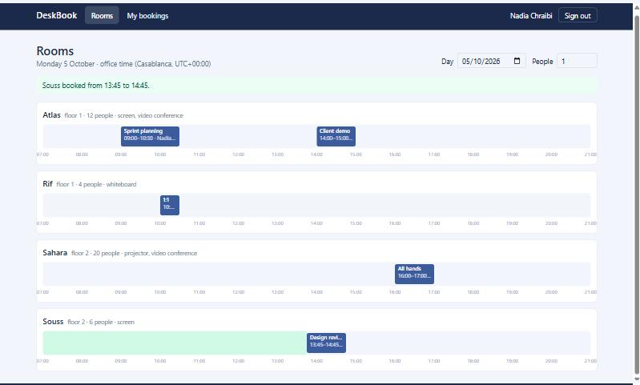

# DeskBook

Meeting room booking for an office: a day view of every room, booking in
quarter-hour slots, cancellation, and room administration. Two people can
never hold the same room at the same time, even when they click at the same
moment.

**C# · .NET 10 · ASP.NET Core Web API · Entity Framework Core · PostgreSQL · JWT · xUnit · Testcontainers · React 19 · TypeScript · TanStack Query · Tailwind CSS · Docker**

[](https://github.com/MedTahaBri2022/deskbook/actions/workflows/ci.yml)



## Features

| Role | Can do |
| --- | --- |
| Employee | See the day of every room (bookings and free time), book a free interval, list and cancel their bookings |
| Admin | The same, plus create rooms, change them, deactivate and reactivate them, cancel anyone's booking |

Office rules: bookings start and end on a quarter of an hour, last from
15 minutes to 8 hours, fit in opening hours (07:00–21:00 office time, Monday to
Friday), are made at most 60 days ahead, and the attendees fit in the room.

## Design decisions

**No double booking, guaranteed by PostgreSQL.** The application first looks
for a clashing booking to give a useful answer (`409` with who holds the room,
without disclosing someone else's meeting title). That check alone loses the
race between two simultaneous requests, so the migration adds an exclusion
constraint:

```sql
ALTER TABLE bookings ADD CONSTRAINT ex_bookings_no_overlap
    EXCLUDE USING gist ("RoomId" WITH =, tstzrange("StartsAt", "EndsAt", '[)') WITH &&)
    WHERE ("Status" = 'Active');
```

The interval is half-open, so 10:00–11:00 and 11:00–12:00 do not overlap, and
a cancelled booking frees its slot. A violation (`23P01`) is turned into a
`409`. A test sends six identical requests at once: exactly one is created.

**Rules in one plain class.** `BookingRules` checks an interval against the
office rules and returns every problem by field; it has no database or HTTP
dependency and its own unit tests.

**Time is handled once, on the server.** Instants are `DateTimeOffset` stored
as `timestamptz`. Office hours are evaluated in `Africa/Casablanca` time from
the server's time zone database, and every instant leaves the API with the
office offset. The React client never converts time zones itself: it reads the
wall-clock time and the offset from the values it receives and works in
minutes from the opening instant of the day.

This is not theoretical. While writing the tests I had assumed Morocco is at
UTC+1; the server's time zone data (tzdata 2026c) puts Casablanca at UTC+0 in
October 2026, while the browser's built-in data still said UTC+1, so the first
version of the day view showed 08:00–22:00. The tests now take local times
from the time zone database instead of a hard-coded offset, and the client
trusts the server's offset.

**A clock that can be injected.** Services use .NET's `TimeProvider`. The tests
replace it with a clock set to Monday 08:00 and move it forward (a booking that
has started cannot be cancelled; past bookings leave "my bookings"). Token
lifetimes are validated against the same clock.

**Security.** JWT (HS256) issued at login and validated by the JWT bearer
handler with short claim names (`sub`, `role`); role-based `[Authorize]` on
the admin endpoints; passwords hashed with ASP.NET Core Identity's
`PasswordHasher`; an unknown e-mail and a wrong password give the same answer
(a dummy hash is checked). The user is reloaded from the database on each
request. The signing key is checked at startup (at least 32 characters).

**Errors** are RFC 9457 problem documents: model validation (`400`) by
`[ApiController]`, business rules (`422`) with errors by field, conflicts
(`409`) with the booking in the way.

**Queries.** The day view loads every room and every booking of the day in two
queries, whatever the number of rooms. Indexes on `(RoomId, StartsAt)` and
`(UserId, StartsAt)`; check constraints on capacity, attendees and intervals.

## Run it

Requirements: Docker.

```bash
docker compose up -d --build          # PostgreSQL, API, web
```

Open <http://localhost:8082>. Demo accounts (password `password`, local demo
only): `nadia@example.com` and `omar@example.com` (employees),
`admin@example.com` (admin). The demo data books a few meetings on the next
working day.

Front-end development with hot reload, against the API of the stack:

```bash
cd web && npm install && npm run dev  # http://localhost:5182
```

## Tests

```bash
dotnet test DeskBook.slnx             # needs Docker for Testcontainers
cd web && npm test
```

- **11 unit tests** of the office rules and of the free intervals.
- **15 integration tests** with `WebApplicationFactory` against a real
  PostgreSQL started by Testcontainers (migrations and exclusion constraint
  included): login, tokens, admin-only endpoints, the day view, overlapping
  and back-to-back bookings, six simultaneous requests for one slot, office
  rules returned by field, model validation, cancellation rights and timing,
  past bookings, office-time offsets in responses.
- **10 front-end tests** (Vitest): the API client, time handling and the
  checks made before sending a booking.
- CI also builds the Docker images, starts the stack and reads a day through
  nginx with a demo account.

## API

| Method | Path | Notes |
| --- | --- | --- |
| POST | `/api/auth/login` | token and profile |
| GET | `/api/me` | current user |
| GET | `/api/rooms/day?date=&minCapacity=` | every active room with its bookings and free intervals |
| GET | `/api/rooms?includeInactive=` | rooms |
| POST / PUT | `/api/rooms`, `/api/rooms/{id}` | admin only |
| GET | `/api/bookings/mine?includePast=` | my bookings |
| POST | `/api/bookings` | `{ roomId, title, attendees, startsAt, endsAt }` |
| POST | `/api/bookings/{id}/cancel` | the person who booked, or an admin |
| GET | `/health` | database included |

## Limits

- One office and one time zone (configurable under `Office`).
- No recurring meetings, no calendar invitations (e-mail, Outlook, Teams).
- PostgreSQL only: the overlap guarantee relies on an exclusion constraint.
  SQL Server would need a different technique (serializable transaction or
  locking hints).
- Migrations run at startup for the demo; a production deployment would run
  them as a separate step (`Database:MigrateOnStartup=false`).
- No refresh token; the session ends when the access token expires (8 hours).

## License

MIT
